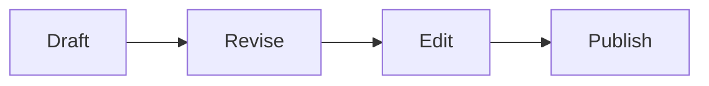

# The Weight of a Sentence

A short document that exercises **every** part of the live preview: *emphasis*,
***both at once***, ~~retraction~~, ==a highlight==, `inline_code()`, and a
[link to somewhere](https://example.com).

## Why syntax should disappear

> The best interface is the one you stop noticing.
> Markdown earns its keep only when it gets out of the way.

Three things matter when drafting long-form prose:

1. The text has to look like the finished thing
2. The controls have to vanish when unused
3. Nothing may interrupt the sentence you are mid-way through

- [x] Hide markers once the cursor leaves
- [x] Render tables, math and diagrams inline
- [ ] Stay out of the writer's way

### A table

| Feature | Shortcut | Notes |
| --- | --- | --- |
| Bold | Ctrl+B | Wraps or unwraps |
| Table | Ctrl+T | Asks for dimensions |
| Focus mode | F8 | Dims other paragraphs |

### Some mathematics

Inline math such as $e^{i\pi} + 1 = 0$ sits in the run of text, while a display
block stands alone:

$$
\int_{-\infty}^{\infty} e^{-x^{2}}\,dx = \sqrt{\pi}
$$

### A diagram



### And some code

```javascript
const wordCount = (text) => (text.match(/[\p{L}\p{N}'-]+/gu) || []).length;
console.log(wordCount("counting words is harder than it looks"));
```

---

#### Closing note

Footnotes work too.[^1] So does H~2~O and E = mc^2^.

[^1]: Rendered at the bottom of the document, as they should be.
